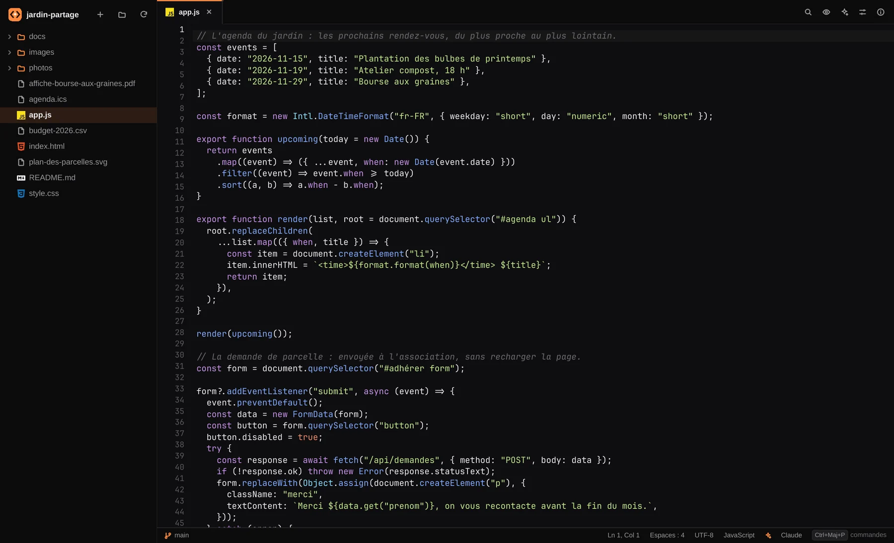

# Flair Code

L'éditeur de code de la suite flair : la même identité, le même thème, et une application
à part qui s'utilise toute seule.



Une application de [la suite flair](https://vexlab-off.github.io/flair/), avec [flair](https://github.com/vexlab-off/flair),
[Flair Code](https://github.com/vexlab-off/flaircode) et [Flair Web](https://github.com/vexlab-off/flairweb).

## Installer

Sur Arch Linux et ses dérivées, ajoute une fois le dépôt de la suite à la fin de
`/etc/pacman.conf` :

```ini
[suite-flair]
SigLevel = Optional TrustAll
Server = https://vexlab-off.github.io/arch/$arch
```

puis :

```sh
sudo pacman -Syu flair-code         # cette app
sudo pacman -Syu suite-flair   # les trois : flair, flair-code, flair-web
```

Les mises à jour arrivent ensuite avec `sudo pacman -Syu`.

Sans le dépôt, avec le paquet de la
[dernière version](https://github.com/vexlab-off/flaircode/releases/latest) :

```sh
sudo pacman -U flaircode-0.1.0-1-x86_64.pkg.tar.zst
```

Ou en construisant le paquet soi-même depuis les sources de la version :

```sh
git clone https://github.com/vexlab-off/flaircode
cd flaircode/packaging/arch
makepkg -si
```

Il faut Qt 6 (base, declarative, webengine, wayland) et xdg-desktop-portal. En option : git, la police JetBrains Mono.


- Arborescence du projet, onglets, un éditeur par fichier avec son propre historique
  d'annulation.
- Coloration syntaxique de C/C++, QML, JavaScript/TypeScript, Python, Rust, Go, Java,
  Kotlin, Dart, Shell, HTML, CSS, JSON, Markdown, YAML, TOML.
- Numéros de ligne, ligne courante, indentation automatique, Tab/Maj+Tab sur plusieurs
  lignes, commentaire des lignes avec Ctrl+/ (Ctrl+: en AZERTY).
- Aller à un fichier (Ctrl+P), rechercher et remplacer (Ctrl+F, Ctrl+H).
- Enregistrement atomique : le fichier est écrit à côté puis renommé, jamais à moitié.
- Un fichier modifié sur le disque se recharge tout seul s'il n'a pas de modification
  en cours ; sinon un bandeau propose de recharger ou de garder ta version.
- Fermer un onglet ou quitter avec des fichiers non enregistrés demande d'abord.
- Les fichiers binaires ne sont pas ouverts, pour ne pas les abîmer.
- Les logos des langages dans l'arborescence et les onglets, la branche Git dans la barre
  d'état, la couleur d'accent partagée avec flair (réglages de flair).

## IA, comme Cursor

- **Assistant** (Ctrl+L) : discute avec Claude, OpenAI, Gemini ou un modèle local
  (LM Studio, Ollama) à propos du fichier ouvert et de la sélection. Chaque bloc de code
  de la réponse se copie, s'insère au curseur ou remplace la sélection.
- **Modifier avec l'IA** (Ctrl+K) : décris un changement, l'avant/après s'affiche, Ctrl+Entrée
  l'accepte. Sans sélection, écrit du code au curseur.
- **Actions rapides** : expliquer, corriger, documenter, écrire des tests, optimiser, revue.
- Clés dans les réglages ou par variables (`ANTHROPIC_API_KEY`, `OPENAI_API_KEY`,
  `GEMINI_API_KEY`) ; « Charger les modèles » liste ceux de ton compte. La clé Claude de
  flair est reprise automatiquement.

## Aide

- **Palette de commandes** (Ctrl+Maj+P) : toutes les commandes par leur nom, les snippets
  du langage, et « :42 » pour aller à une ligne.
- **Snippets** : `for`, `if`, `class`, `fn`, `html`, `flex`, `qobject`… puis Tab, pour
  C/C++, JavaScript/TypeScript, Python, QML, HTML, CSS, Shell, Rust, Go, Markdown, JSON.
- **Aide** (F1) : raccourcis, snippets par langage, guide de l'IA et astuces.

## Aperçu en direct

Ctrl+Maj+V ouvre l'aperçu à côté du code : HTML et SVG rendus à chaque frappe, Markdown
mis en forme, et l'image dont le chemin est sous le curseur. Les images (PNG, JPEG, WebP…)
s'ouvrent en aperçu dans un onglet, avec leurs dimensions.

## Réglages (Ctrl+,)

- **Apparence** : thèmes d'éditeur Vex, Braise, Minuit, Contraste, Papier ; couleur
  d'accent commune avec flair ou propre.
- **Couleurs de l'éditeur** : fond, texte, numéros, ligne courante, sélection, curseur…
- **Coloration syntaxique** : une couleur, du gras et de l'italique par élément (mots-clés,
  types, fonctions, chaînes, nombres, commentaires, balises…).
- **Éditeur** et **Aide à l'écriture** : police, taille, indentation, numéros, retour à la
  ligne, fermeture des parenthèses, snippets, enregistrement automatique, nettoyage à
  l'enregistrement.
- **IA** : fournisseur par défaut, clés, modèles.

`flaircode dossier` ouvre un projet ; `flaircode fichier` ouvre le projet qui le contient
(son dépôt Git) avec le fichier. Ctrl+O ouvre un dossier avec le sélecteur du système.

## Raccourcis

| Touche | Action |
|---|---|
| Ctrl+Maj+P | Palette de commandes |
| Ctrl+L | Assistant IA |
| Ctrl+K | Modifier avec l'IA |
| Ctrl+Maj+V | Aperçu en direct |
| Ctrl+O | Ouvrir un dossier |
| Ctrl+Maj+O | Ouvrir un chemin |
| Ctrl+G | Aller à la ligne |
| Ctrl+P | Aller à un fichier |
| Ctrl+N | Nouveau fichier |
| Ctrl+S / Ctrl+Maj+S | Enregistrer / tout enregistrer |
| Ctrl+W | Fermer l'onglet |
| Ctrl+Tab / Ctrl+Maj+Tab | Onglet suivant / précédent |
| Ctrl+Z / Ctrl+Maj+Z | Annuler / rétablir |
| Tab / Maj+Tab | Indenter / désindenter |
| Ctrl+/ (Ctrl+:) | Commenter les lignes |
| Ctrl+Maj+D / Ctrl+Maj+K | Dupliquer / supprimer la ligne |
| Alt+↑ / Alt+↓ | Déplacer les lignes |
| Alt+Z | Retour à la ligne |
| Ctrl+Maj+T | Thème suivant |
| Ctrl+F / Ctrl+H | Rechercher / remplacer |
| F3 / Maj+F3 | Résultat suivant / précédent |
| Ctrl+B | Arborescence |
| Ctrl+= / Ctrl+- / Ctrl+0 | Taille du texte |
| F1 | Aide |
| Ctrl+Q | Quitter |

## Développement

```sh
bin/build      # build/flaircode
bin/test       # tests Qt Test, hors écran
bin/install    # paquet Arch : lanceur, icône
```

`FLAIRCODE_SNAPSHOT=capture.png QT_QPA_PLATFORM=offscreen build/flaircode fichier` enregistre
une image de la fenêtre sans l'afficher, pour vérifier l'interface.

## Licence

MIT, voir [LICENSE](LICENSE). La suite flair est créée par vex.
